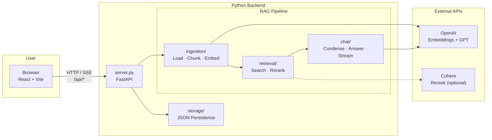
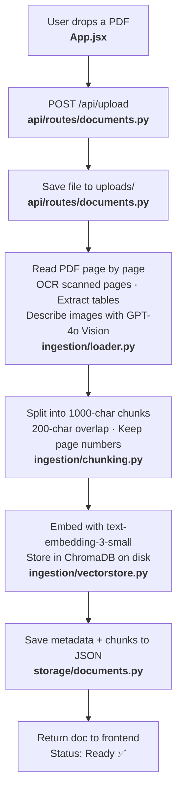
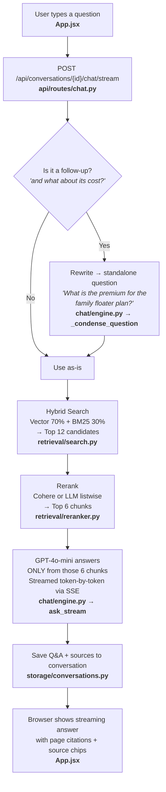

# AssistFlow — Project Architecture Guide

> **What is this?** A complete guide to every folder and file in the project, written so you can walk an interviewer through it confidently — from "here's what it does" to "here's the order I built it in and why."

---

## The One-Sentence Pitch

> *"Upload any PDF or paste a website URL, ask questions in plain English, and get answers that come **only** from your document — with page citations and clickable source chunks you can verify."*

---

## High-Level Architecture



---

## Complete Folder Structure

```
assistFlow/
│
├── 📄 README.md                    # Public-facing — what it is, screenshots, how to start
├── 📄 PROJECT_MANUAL.md            # Deep internal guide (the original build story)
├── 📄 .gitignore                   # Keeps .env, db/, uploads/, node_modules/ out of Git
│
├── 📁 docs/                        # Sample documents + screenshots
│   ├── attention-is-all-you-need.pdf   # Sample PDF for testing
│   ├── Google.txt, Microsoft.txt ...   # Sample text files (used by archived lessons)
│   ├── synthetic_questions.txt         # Test questions
│   └── screenshots/                    # README screenshots
│       ├── chat-with-web-source.png
│       └── per-pdf-chat-history.png
│
├── 📁 frontend/                    # React + Vite UI  ← UNTOUCHED
│   ├── index.html                  # HTML shell (Vite mounts React here)
│   ├── package.json                # Dependencies: react, vite
│   ├── vite.config.js              # Dev server config + proxy /api → localhost:8000
│   └── src/
│       ├── main.jsx                # Entry point — renders <App />
│       ├── App.jsx                 # Main dashboard — 3-pane layout, chat, upload, history
│       ├── PipelineModal.jsx       # 6-step pipeline inspector modal (clickable from sources)
│       ├── api.js                  # Fetch wrappers + SSE stream reader for all backend calls
│       └── styles.css              # Dark-themed responsive CSS
│
└── 📁 python/                      # Backend — the RAG engine + API
    ├── 📄 config.py                # ① Centralized settings (env vars, paths, model names)
    ├── 📄 server.py                # ② FastAPI entry point (mounts all routers)
    ├── 📄 requirements.txt         # Production dependencies only
    ├── 📄 .env.example             # Template for API keys
    ├── 📄 .env                     # Actual keys (gitignored)
    │
    ├── 📁 ingestion/               # STAGE 1 — Document → Searchable Chunks
    │   ├── __init__.py             # Re-exports: load_and_split_pdf, get_vector_store, etc.
    │   ├── loader.py               # ③ Load PDFs, web text, OCR scanned pages, describe images
    │   ├── chunking.py             # ④ Split into 1000-char chunks with page metadata
    │   └── vectorstore.py          # ⑤ Embed chunks (OpenAI) → store in ChromaDB (per-doc)
    │
    ├── 📁 retrieval/               # STAGE 2 — Question → Best Chunks
    │   ├── __init__.py             # Re-exports: build_hybrid_retriever, rerank, etc.
    │   ├── search.py               # ⑥ Hybrid search: vector (70%) + BM25 keyword (30%)
    │   └── reranker.py             # ⑦ Cohere Rerank or LLM listwise rerank → top 6
    │
    ├── 📁 chat/                    # STAGE 3 — Chunks → Answer
    │   ├── __init__.py             # Re-exports: PdfChat
    │   └── engine.py               # ⑧ PdfChat class: condense → retrieve → answer → stream
    │
    ├── 📁 api/                     # HTTP layer — translates HTTP ↔ pipeline
    │   ├── __init__.py
    │   ├── models.py               # ⑨ Pydantic schemas (UrlIn, ChatIn, ConvChatIn)
    │   ├── helpers.py              # ⑩ HTML parser, URL safety, partition stats, source mapping
    │   ├── state.py                # ⑪ Shared in-memory chat caches (_chats, _conv_chats)
    │   └── routes/
    │       ├── __init__.py
    │       ├── documents.py        # ⑫ Upload PDF/URL, list, get, delete + ingestion pipeline
    │       ├── conversations.py    # ⑬ Create/list/get/delete per-document chat histories
    │       └── chat.py             # ⑭ Chat + SSE streaming endpoints
    │
    ├── 📁 storage/                 # Persistence layer — JSON file CRUD
    │   ├── __init__.py             # Re-exports all CRUD functions
    │   ├── documents.py            # ⑮ Document metadata → data/<doc_id>.json
    │   └── conversations.py        # ⑯ Chat history → data/conversations/<conv_id>.json
    │
    ├── 📁 _archive/                # Study-only files (not used by the app)
    │   ├── 01_ingestion_pipeline.py ... 13_reranker.py
    │   └── (13 standalone learning scripts — kept for reference only)
    │
    ├── 📁 data/                    # ⚙ Runtime — created automatically
    │   ├── <doc_id>.json           # Document metadata + chunk list
    │   └── conversations/
    │       └── <conv_id>.json      # Chat messages + sources per conversation
    ├── 📁 db/                      # ⚙ Runtime — per-document ChromaDB vector stores
    └── 📁 uploads/                 # ⚙ Runtime — uploaded PDF files / extracted web text
```

---

## Build Order — What I Created First and Why

> *"If I were building this from scratch, here's the order and reasoning."*

### Phase 1 — The Engine (can run with zero UI)

| Step | File | Why this comes first |
|------|------|---------------------|
| **①** | `config.py` | Every module needs settings — define all env vars, paths, and model names in one place before anything else |
| **②** | `ingestion/loader.py` | The first problem to solve: *"How do I read a PDF page by page?"* — includes text extraction, OCR for scanned pages, table detection, and image descriptions |
| **③** | `ingestion/chunking.py` | Raw pages are too big for LLM context windows. Split them into 1000-char chunks with 200-char overlap so context is preserved at boundaries |
| **④** | `ingestion/vectorstore.py` | Chunks need to be searchable. Embed them with OpenAI and store in ChromaDB — one persistent store per document, so re-uploads don't re-embed |

> **At this point:** I can load any PDF, chunk it, and embed it. No search yet, no answers.

### Phase 2 — The Retrieval Pipeline

| Step | File | Why |
|------|------|-----|
| **⑤** | `retrieval/search.py` | Now I need to find the right chunks for a question. Pure vector search misses exact terms ("clause 4.2", "₹5000"), so I combine vector (semantic) + BM25 (keyword) in a 70/30 ensemble |
| **⑥** | `retrieval/reranker.py` | 12 retrieved chunks is too many for the LLM. A reranker (Cohere, or fallback LLM listwise) picks the 6 most relevant — quality jumps noticeably |

> **At this point:** Given a question, I can find the best 6 chunks from any document.

### Phase 3 — The Chat Engine

| Step | File | Why |
|------|------|-----|
| **⑦** | `chat/engine.py` | The `PdfChat` class ties it all together: condense follow-up questions → hybrid search → rerank → GPT answers ONLY from the chunks → stream tokens. This is the core product |

> **At this point:** The full RAG pipeline works. I could use it from a Python REPL.

### Phase 4 — The API Layer

| Step | File | Why |
|------|------|-----|
| **⑧** | `storage/documents.py` | The API needs to remember uploaded documents across restarts — simple JSON file CRUD |
| **⑨** | `storage/conversations.py` | Same for chat history — each conversation is a JSON file, grouped by document |
| **⑩** | `api/models.py` | Define the HTTP request shapes (Pydantic) |
| **⑪** | `api/helpers.py` | Utility functions the routes need: HTML parser for web URLs, SSRF protection, partition stats for the pipeline modal |
| **⑫** | `api/state.py` | In-memory caches so each question doesn't reload the vector store from disk |
| **⑬** | `api/routes/documents.py` | Upload PDF, upload URL, list/get/delete — calls the ingestion pipeline |
| **⑭** | `api/routes/conversations.py` | CRUD for per-document conversations |
| **⑮** | `api/routes/chat.py` | The two chat endpoints — synchronous + SSE streaming |
| **⑯** | `server.py` | 10-line file that creates the FastAPI app and mounts the three routers |

> **At this point:** The backend is complete. All 13 endpoints work via `curl` or Postman.

### Phase 5 — The Frontend (built LAST)

| Step | File | Why |
|------|------|-----|
| **⑰** | `frontend/src/api.js` | Thin wrappers over `fetch()` for every backend endpoint + SSE stream reader |
| **⑱** | `frontend/src/App.jsx` | The main UI — 3-pane layout: history sidebar, document list, active chat |
| **⑲** | `frontend/src/PipelineModal.jsx` | The interactive 6-step pipeline inspector (opens when you click a source chip) |
| **⑳** | `frontend/src/styles.css` | Visual polish — dark theme, responsive layout |

---

## The Three Rules of This Architecture

> These are great to state clearly in an interview:

**1. Separation of concerns — each module does ONE thing**
```
ingestion/   → "document in, chunks out"
retrieval/   → "question in, best chunks out"
chat/        → "question + chunks in, answer out"
api/         → "HTTP in, JSON out"
storage/     → "data in, file out"
```

**2. The engine knows nothing about HTTP**
- `ingestion/`, `retrieval/`, and `chat/` have zero imports from `fastapi`.
- They can be used from a CLI, a Streamlit app, a notebook, or any other interface.
- `api/` is the **translator** between HTTP and the engine.

**3. The frontend knows nothing about the engine**
- React only talks to `/api/*` URLs.
- It doesn't know about ChromaDB, LangChain, or OpenAI.
- If I replaced the entire Python backend with a Go server that served the same JSON, the frontend would work unchanged.

---

## The RAG Pipeline — Step by Step

> *"Here's what happens when a user uploads a PDF and asks a question."*

### Upload Flow



### Chat Flow



---

## Key Design Decisions to Highlight in an Interview

| Decision | Why |
|----------|-----|
| **Hybrid search (vector + BM25)** | Pure vector search misses exact terms, clause numbers, and amounts. BM25 catches keywords. The 70/30 ensemble covers both. |
| **Reranking** | Retrieval returns 12 candidates — too noisy. Reranking picks the 6 most relevant, dramatically improving answer quality. |
| **Follow-up condensation** | "and what about its cost?" is meaningless without context. We rewrite it into "What is the premium for the family floater plan?" before searching. |
| **Per-document vector stores** | Each PDF gets its own ChromaDB folder. No cross-contamination. Delete a document → delete its vectors. |
| **SSE streaming** | Users see the answer appear word-by-word instead of waiting 5-10 seconds. Much better UX. |
| **Multi-modal ingestion** | Scanned pages → GPT-4o OCR. Tables → structured "cell \| cell" chunks. Images → GPT-4o descriptions. Everything becomes searchable text. |
| **Strictly grounded answers** | The system prompt says: *"If the answer is not in these excerpts, say exactly: I don't have enough information..."* — prevents hallucination. |
| **Cost caps** | `OCR_MAX_PAGES=30`, `IMAGE_MAX_DESCRIBE=15` — a 200-page scanned PDF won't burn \$50 in vision API calls. |

---

## API Endpoints — Quick Reference

| Method | URL | Purpose | Route file |
|--------|-----|---------|------------|
| `GET` | `/api/health` | Backend + key status | `server.py` |
| `GET` | `/api/documents` | List all uploaded sources | `routes/documents.py` |
| `GET` | `/api/documents/{id}` | Full doc metadata + chunks | `routes/documents.py` |
| `POST` | `/api/upload` | Upload a PDF file | `routes/documents.py` |
| `POST` | `/api/upload-url` | Add a web page source | `routes/documents.py` |
| `DELETE` | `/api/documents/{id}` | Remove doc + vectors + chats | `routes/documents.py` |
| `GET` | `/api/documents/{id}/conversations` | List chats for a document | `routes/conversations.py` |
| `POST` | `/api/documents/{id}/conversations` | Create a new chat | `routes/conversations.py` |
| `GET` | `/api/conversations/{id}` | Full chat with messages | `routes/conversations.py` |
| `DELETE` | `/api/conversations/{id}` | Delete a chat | `routes/conversations.py` |
| `POST` | `/api/conversations/{id}/chat` | Ask (synchronous) | `routes/chat.py` |
| `POST` | `/api/conversations/{id}/chat/stream` | Ask (SSE streaming) ← **main one** | `routes/chat.py` |

---

## Tech Stack Summary

| Layer | Technology | Why this choice |
|-------|-----------|-----------------|
| **Frontend** | React 18, Vite | Fast dev server, hot reload, simple component model |
| **Backend** | FastAPI, Uvicorn | Async-ready, automatic OpenAPI docs, Pydantic validation |
| **Embeddings** | OpenAI `text-embedding-3-small` | Best quality/cost ratio for semantic search |
| **Vector DB** | ChromaDB (on disk) | Zero infrastructure — just a folder per document, no server needed |
| **LLM** | OpenAI `gpt-4o-mini` (answers), `gpt-4o` (vision/OCR) | Mini for fast cheap answers, full 4o only for image understanding |
| **Search** | LangChain EnsembleRetriever + rank-bm25 | Combines semantic + keyword search in one call |
| **Rerank** | Cohere Rerank v3 / LLM fallback | Cohere is best-in-class; LLM fallback means it works with just an OpenAI key |
| **PDF** | PyMuPDF + pypdf | PyMuPDF for tables/images/rendering, pypdf for clean text extraction |
