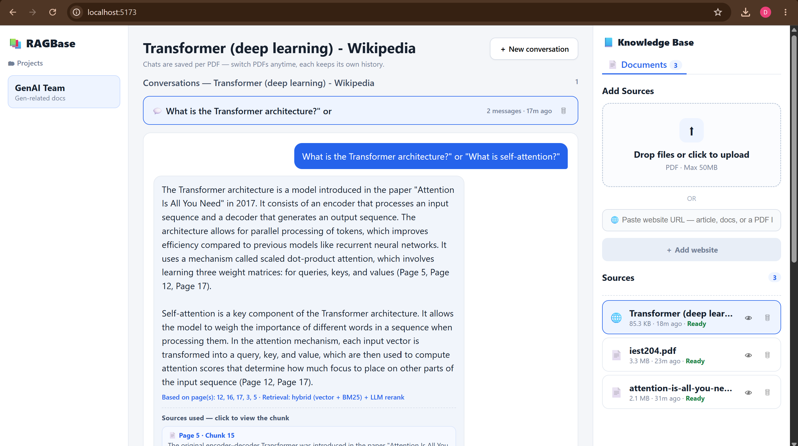
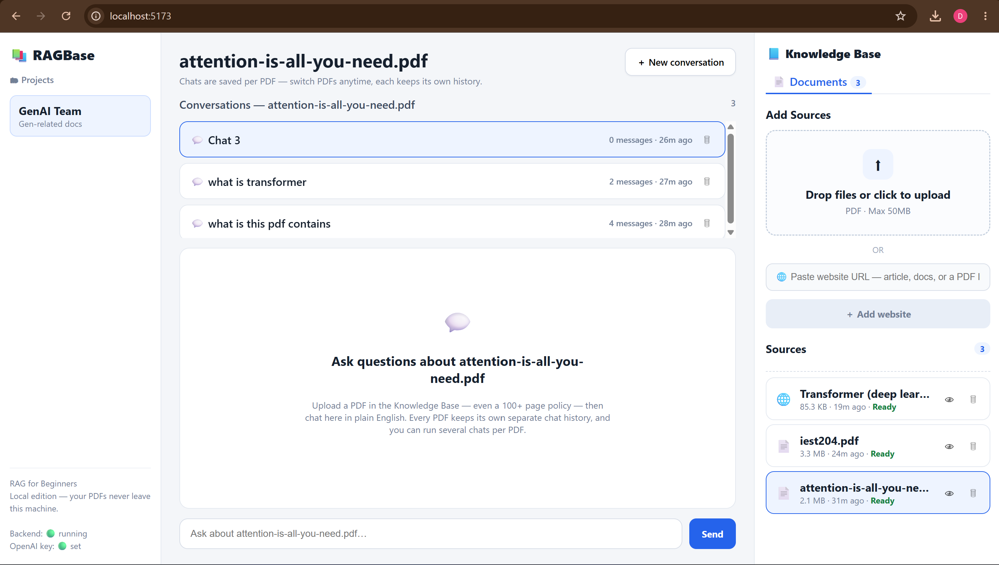

#AssistFlow— Chat with Your PDFs & Web Pages

A full-stack **Retrieval-Augmented Generation (RAG)** web app. Upload a PDF (even a 100+ page policy or research paper) or paste a website URL, then ask questions in plain English. Every answer is generated **only from your document**, with **page-level citations** and **clickable source chunks** so you can verify exactly where it came from.

Built with **React + FastAPI + LangChain + ChromaDB + OpenAI**.

---

## Screenshots

**Chatting with a web page** — the Wikipedia Transformer article loaded from a URL, answered with page citations, hybrid retrieval, and clickable sources:



**Per-document chat history** — every PDF keeps its own separate conversations, which survive restarts:



---

## Features

- **Two source types** — upload PDFs (up to 50MB) or paste a website URL (articles, docs pages, or direct PDF links)
- **Multi-modal ingestion** — extracts text, **tables** (PyMuPDF), **images** (described by GPT-4o Vision), and **scanned pages** (OCR via GPT-4o Vision), so all PDF content becomes searchable
- **Hybrid search + reranking** — OpenAI embeddings + BM25 retrieve the top 12 chunks, an LLM/Cohere reranker selects the best 6
- **Follow-up aware** — questions like *"and what about its cost?"* are automatically rewritten into standalone queries using the chat history before searching
- **Streaming answers** — replies appear token-by-token over Server-Sent Events
- **Verifiable answers** — page citations on every answer, plus the exact source chunks used, one click away
- **Visual processing pipeline** — click any source to see how it was processed: Upload → Partitioning → Chunking → Summarisation → Vectorization & Storage, and inspect every chunk
- **Per-document chat history** — multiple saved conversations per PDF, stored locally and restored on restart
- **Fully local** — your documents, embeddings, and chats never leave your machine (only OpenAI API calls go out)

## How it works

```
PDF / URL → extract text, tables, images (OCR) → split into chunks (1000 chars, 200 overlap)
          → embed with text-embedding-3-small → store in ChromaDB (one store per document)
Question  → rewrite follow-ups using history → hybrid search (vector + BM25, top 12)
          → rerank to top 6 → GPT-4o-mini answers from those chunks only → streamed reply with citations
```

## Tech stack

| Layer | Technology |
|---|---|
| Frontend | React, Vite |
| Backend | Python, FastAPI (13 REST endpoints), Uvicorn |
| RAG | LangChain, ChromaDB, BM25 (rank-bm25), EnsembleRetriever |
| Models | OpenAI `text-embedding-3-small`, `gpt-4o-mini` (answers), `gpt-4o` (vision/OCR), optional Cohere Rerank |
| PDF processing | PyMuPDF, pypdf |

---

## Getting started

### Prerequisites

- Python 3.11+
- Node.js 18+
- An [OpenAI API key](https://platform.openai.com/api-keys)

### 1. Set up the backend

```powershell
cd python
pip install -r requirements.txt
copy .env.example .env
notepad .env
```

In the `.env` file, paste your key and save:

```
OPENAI_API_KEY=sk-your-key-here
```

### 2. Start the backend (Terminal 1 — leave it running)

```powershell
cd python
uvicorn api_server:app --port 8000
```

Check it: open http://localhost:8000/api/health — you should see `{"ok":true,"openai_key_set":true}`.

### 3. Start the frontend (Terminal 2 — new window)

```powershell
cd frontend
npm install
npm run dev
```

### 4. Open the app

Open the **Local:** address Vite prints — normally **http://localhost:5173**

1. Upload a PDF (or paste a website URL) in the **Knowledge Base** panel
2. Wait for the source to show **Ready**
3. Ask a question in plain English — try a follow-up like *"and what about…?"* and click a source chip under the answer

**To stop:** press `Ctrl+C` in each terminal.

### Optional: CLI and Streamlit versions

The same RAG engine also runs without the web UI, from the `python` folder:

```powershell
python pdf_rag_app.py --pdf ..\docs\attention-is-all-you-need.pdf
streamlit run app_streamlit.py
```

---

## Project structure

```
multi-model-rag/
├── README.md              # This file
├── PROJECT_MANUAL.md      # Complete guide to every folder and file
├── python/
│   ├── rag_core.py        # RAG engine: loading, chunking, embeddings, hybrid search, rerank, OCR/vision
│   ├── api_server.py      # FastAPI backend (13 endpoints, SSE streaming)
│   ├── pdf_rag_app.py     # Command-line version
│   ├── app_streamlit.py   # Streamlit version
│   ├── 01_...py – 13_...py  # The 13 RAG lessons as plain Python (chunking, hybrid search, reranker, multi-modal…)
│   ├── data/              # Saved conversations (created at runtime)
│   ├── db/                # Per-document ChromaDB stores (created at runtime)
│   └── uploads/           # Uploaded files (created at runtime)
├── frontend/              # React + Vite UI
└── docs/                  # Sample documents + screenshots
```

## Configuration (`.env`)

| Variable | Default | Purpose |
|---|---|---|
| `OPENAI_API_KEY` | — (required) | Your OpenAI key |
| `OPENAI_CHAT_MODEL` | `gpt-4o-mini` | Answer model (set `gpt-4o` for higher quality) |
| `OPENAI_VISION_MODEL` | `gpt-4o` | Model used for image descriptions and OCR |
| `COHERE_API_KEY` | — (optional) | If set, reranking uses Cohere instead of the LLM |
| `OCR_MAX_PAGES` | `30` | Max scanned pages to OCR per PDF |
| `IMAGE_MAX_DESCRIBE` | `15` | Max images to describe per PDF |

## API at a glance

`GET /api/health` · `GET /api/documents` · `POST /api/upload` · `POST /api/upload-url` · `GET /api/documents/{id}` · `DELETE /api/documents/{id}` · `GET|POST /api/documents/{id}/conversations` · `GET|DELETE /api/conversations/{id}` · `POST /api/conversations/{id}/chat` · `POST /api/conversations/{id}/chat/stream` (SSE)

---


Built by **Diwakar Shaw** · [GitHub](https://github.com/Diwakar1706) · [LinkedIn](https://www.linkedin.com/in/diwakarshaw)
